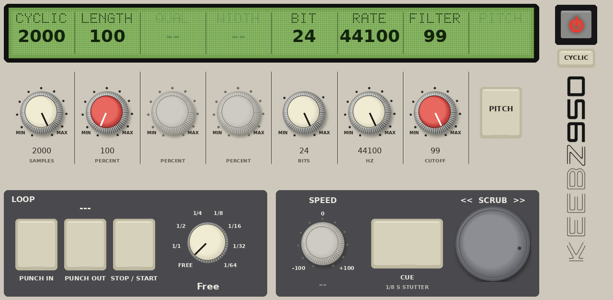
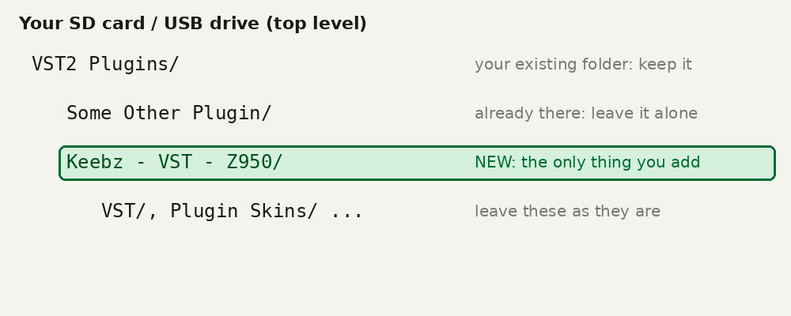
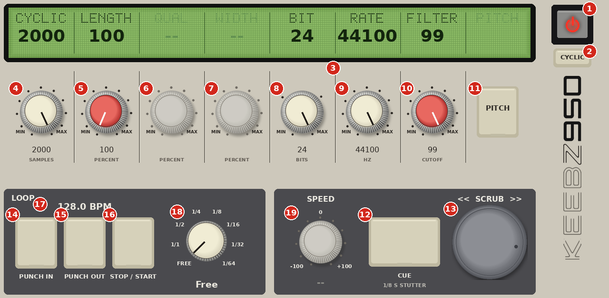
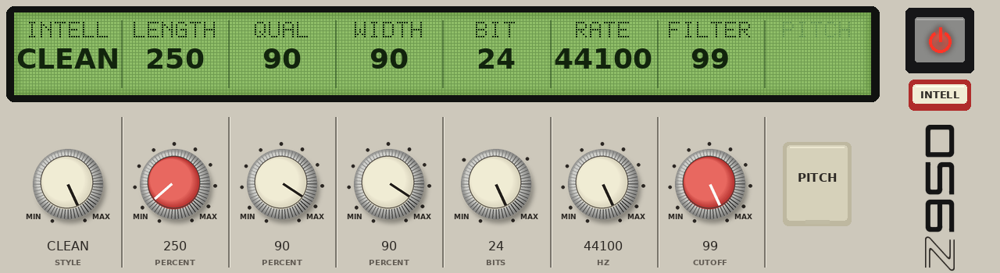
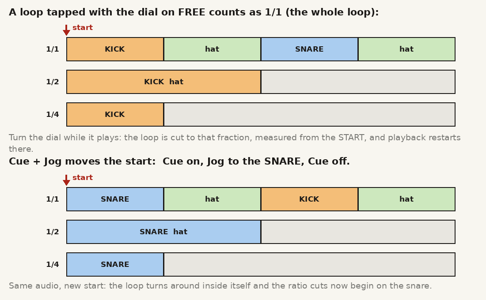

<div align="center">


# Z950

**Live S-series time stretch, S950 filter, CD-deck cue/scrub and looper &mdash; an insert effect for Akai MPC**

[](https://github.com/keebz/Z950/releases)
[](LICENSE)
[](#requirements)
[](#requirements)

</div>


> [!CAUTION]
> **Z950 is experimental software, provided "AS IS", without warranty of any kind, express or implied.**
> You use it entirely at your own risk. It was made and tested on an **MPC Live III** only; other MPC models that run
> external plugins should load it but are untested. Not affiliated with, endorsed by or connected to Akai Professional
> or inMusic. All code is original; no Akai code or data is included.

<p align="center"></p>

## What it is

Z950 is an **insert effect**: put it on a track and play audio through it. It records the live input and can

- **stretch** it like an Akai S1000 (CYCLIC and INTELL modes) &mdash; longer and slower with no pitch change, then snap back to live;
- **shift pitch** the S-series way (stretch, then resample);
- **crunch** it with 8 / 12 / 16 / 24-bit and sample-rate reduction, then pass it through a **1:1 S900/S950 low-pass filter**;
- **loop** it with Punch In / Punch Out, cut the loop in note fractions, and change its speed like a turntable;
- **cue and scrub** it like a CD deck.

The touch screen is styled after an Akai S950 front panel, and a two-page HELP tab inside the plugin explains every control.
With every control at its start value the audio passes through untouched, with no delay.

## Downloads

Get the files from the **[Releases page](https://github.com/keebz/Z950/releases)**:

| File | What it is |
|---|---|
| `Keebz - Z950 v1_0.zip` | The plugin &mdash; the folder you copy to your drive |
| `Z950 Quick Start.pdf` | The Quick Start guide (10 pages, also in this repo) |

## Requirements

- An Akai MPC running **MPC OS 3.10.1 or later** (tested on the **MPC Live III**; other models untested)
- An SD card or USB drive, or the MPC's internal drive in computer mode, and a computer to copy the files
- **External Plugin Support** switched on (step 1 below)

## Installation

1. **Enable external plugins on the MPC.** Open *Preferences > Enhancements (Beta)* and switch on
   **Enable Enhancements** and **External Plugin Support**. Restart the MPC if it asks.
2. **Download and unzip** `Keebz - Z950 v1_0.zip`. It holds one folder, `VST2 Plugins`, which holds one folder,
   `Keebz - VST - Z950`.
3. **Merge, do not replace.** If your drive already has a `VST2 Plugins` folder, open it and copy **only** the
   `Keebz - VST - Z950` folder into it. Replacing your existing `VST2 Plugins` folder would remove your other plugins.
   Keep the folder name exactly as it is.

   <p align="center"></p>

4. **Put the drive back** in the MPC (or mount the internal drive) and let it rescan.
5. **Use it.** On a track, add an insert effect and choose **Z950** from the Keebz plugins. Press the **HELP** key in the
   plugin for the on-screen guide, or read the Quick Start PDF.

To remove it, delete the `Keebz - VST - Z950` folder from `VST2 Plugins`.

## Quick tour

<p align="center"></p>

| # | Control | # | Control |
|---|---|---|---|
| 1 | Power | 11 | Pitch on/off |
| 2 | Mode: CYCLIC / INTELL | 12 | Cue |
| 3 | Display | 13 | Scrub (jog) wheel |
| 4 | Cyclic / Style | 14 | Punch In |
| 5 | Length | 15 | Punch Out |
| 6 | Qual | 16 | Stop / Start |
| 7 | Width | 17 | Loop tempo |
| 8 | Bit | 18 | Loop dial |
| 9 | Rate | 19 | Speed |
| 10 | Filter | | |

**Stretch it:** raise **Length** above 100 (the red knob). 200 = twice as long, up to 2000. Bring it back to 100 and you are
live again. Put Length on a pad or a Q-Link and play it like an instrument.

<p align="center"></p>

**INTELL mode** (press the small Mode key; its outline turns red) searches for the best cycle itself, which usually sounds
smoother. The first knob becomes the ORIG / CLEAN style; Qual and Width come alive.

**Loop it:** Punch In marks the start, Punch Out marks the end and starts the loop. Turn the loop dial to cut it to 1/2 ... 1/64.

<p align="center"></p>

## Controls in detail

| Control | Does |
|---|---|
| **POWER** key (top left) | Takes the plugin out of the circuit: audio passes straight through, no delay, no effect, any loop is dropped. The power symbol glows bright red while on. |
| **MODE** key (small key under POWER) | CYCLIC or INTELL stretch, as on the S1000. The outline turns red in INTELL mode; the first LCD column reads INTELL and the first knob becomes the ORIG / CLEAN style; Qual and Width are inactive (greyed, "--") in CYCLIC. Pitch works in both modes. |
| **Length** 100-2000 % | 100 = off. Above 100 stretches the live input without changing pitch; back to 100 snaps to live. With Pitch on the knob spans 100-300 % (finer). |
| **Cyclic / Style** | CYCLIC mode: length of the cycle that is inserted (0 = Auto, searched like INTELL). INTELL mode: the same knob is the STYLE, ORIG (the S1000 lag search exactly as the ROM has it) or CLEAN (default; avoids the 1 ms comb on drums). Each mode keeps its own value. |
| **Qual** 0-100 | INTELL: QUAL+1 comparison points when searching for the best cycle. |
| **Width** 0-100 | INTELL: crossfade of (WIDTH+1) cycles, up to the whole gap between insertions. |
| **Bit** 8/12/16/24 | Output bit depth; all the way right (24) is untouched. |
| **Rate** 8000-44100 Hz | True sample-rate reduction. |
| **Filter** 0-99 | The Akai S900/S950 low-pass, 1:1, last in the chain: a 6th-order Butterworth (-36 dB/oct, no resonance; National MF6-50 in the original) on the S950's own 0-99 scale and cutoff law, read from the S950 v1.2b ROM (index 70 + floor(1.25 F) clamped to 98..170, integer clock dividers): 0 to ~22 = 314 Hz, 22 to 80 = six octaves up to ~20 kHz, above 80 = open. Not modelled: the chip's clock feedthrough and its aliasing around the clock frequency. |
| **Pitch** | On: Length shifts pitch (stretch then resample, duration stays; 200 = +1 octave). The PITCH header is greyed while off. |
| **Speed** -100..+100 | Turntable-style speed (0 = normal; the knob catches at 0, inside +-3 it snaps to 0; a new loop resets it to 0; +100 = twice as fast, -100 = stopped) of the audio stored in the looper and of the Cue stutter only; it acts at once and is greyed out (--) while no loop is running and Cue is off. Pitch off keeps the pitch (overlap-add player, about 30 ms grains); Pitch on makes the pitch follow. In Cue the stutter repeats faster or slower. |
| **Cue** | Stutters the last 1/8 s; press again to go back to live. In a loop, releasing Cue moves the loop's start to where the stutter began (Cue on, Jog to the new start, Cue off): the loop rotates inside its own audio. Lit while on. |
| **Jog** | While Cue is on, one step = one CD frame (13 ms), +-400 frames (about 5 s) from where Cue was pressed. Touch-drag, main encoder or Q-Link. For the touch strip: the MPC sends no MIDI to effect plugins, so put the strip in Crossfader mode and assign the Jog parameter to it in Q-Link Edit. |
| **Punch In / Out** | Loop start / end. In is lit while a start is set, Out while a loop exists; Out again throws the loop away. |
| **Stop / Start** | Stops the loop WITHOUT dumping it (live audio comes back) and starts the same loop again from its start. A stopped loop is kept for about 40 s. The loop's BPM is shown above the three keys. |
| **Loop dial** | FREE, 1/1, 1/2, 1/4, 1/8, 1/16, 1/32, 1/64. A loop tapped with the dial on FREE is not tied to the sequence tempo: it counts as 1/1, its BPM is shown, and turning the dial cuts it to that fraction of its own length, measured from its start, restarting playback there. A length chosen before punching in makes a tempo-locked loop (snaps to the grid, follows tempo changes). |

Screen order: Cyclic/Intell, Length, Qual, Width, Bit, Rate, Filter, Pitch. Q-Link pages follow it: 1 = Cyclic Length Qual Width, 2 = Bit Rate Filter Pitch, 3 = Jog wheel + Speed, 4 = Loop dial.
Hold Shift while turning a Q-Link or the main encoder for finer steps (most useful on Length, Cyclic, Rate, Filter and Jog).
The HELP tab has two pages (press the HELP key again for page 2).

## How the stretch works (from the S1000 v4.4 firmware)
Stretching by a factor s inserts one cycle of length L every D = L*s/(s-1) samples; the read position jumps back by L and the two
read positions are crossfaded over min((WIDTH+1)*L, D). CYCLIC: L is the Cyclic value. INTELL: L is the lag (40-2000 samples at 44.1 kHz) at which
the audio best matches itself, found by a sum-of-absolute-differences search (QUAL+1 points, coarse step 8 then step 2). Written
from scratch; no Akai code or data is included.

## Status
- Desktop verified: host simulator (20 passed), DSP tests (stretch keeps pitch in both modes, INTELL is smoother than CYCLIC on harmonic
  material, pitch-on Length remap, loops at 1/4..1/64, cue 1/4 and 1/8 s repeats, lit keys), INTELL about 1 % of real time on a PC.
- NOT verified on a real MPC: screen drawing, touch, Q-Link pages, the host refreshing the screen when the plugin changes a parameter
  itself (done from a small helper thread), and INTELL CPU load on the MPC.
- The comparison window is capped at 2048 samples (the firmware's is 16384) to keep latency down; the stretch starts about 50-60 ms behind live.
- The skin is generated by `tools/make_skin.py` (Pillow) into `skins/`.

## INTELL notes

The INTELL search follows the Akai S1000 v4.4 ROM: lags 40..2000 samples at 44.1 kHz, 2 x (QUAL+1) comparison points, a window of
lag x min(D/L, WIDTH+1) samples, a coarse pass at step 8 and a step-2 refinement, then a linear crossfade of
min((WIDTH+1) x L, D) samples. Two differences are there for live use (the comparison window is capped at 2048 samples, and the
lag is searched about every 8 ms). One is an addition: the ROM's raw difference sum favours the shortest lag on sounds without
a clear pitch (hi-hats, drum breaks), which turns the splice into a continuous 1 ms comb filter ("washy"). When the search ends on
the shortest lags it is repeated for lags of at least 5 ms.

## Credits and licence

By **Keebz** &mdash; [Keebz.com](https://Keebz.com) &middot; Instagram [@LeeKebler](https://instagram.com/LeeKebler) &middot; [GitHub](https://github.com/Keebz)

Licence: [MIT](LICENSE). Built with the [inMusic MPC Plugin SDK](https://github.com/inmusic-software/mpc-plugin-builder-sdk)
(MIT); see [THIRD_PARTY_NOTICES.md](THIRD_PARTY_NOTICES.md). Original code, not affiliated with Akai. The stretch and filter
behaviour (algorithms and constants) was worked out by studying the S1000 and S950 firmware; the code is written from scratch and
no Akai code or data is included.

## Build from source

```bash
python3 tools/make_skin.py          # regenerate the skin (Pillow)
python3 tools/make_quickstart.py    # regenerate the Quick Start PDF
```

The plugin itself is built with the SDK (`python3 tools/build.py plugins/Z950` in the SDK checkout); the source is `src/DeepStretch.cpp` (the internal class name predates the Z950 rename).
